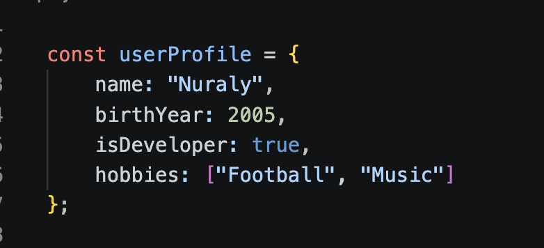
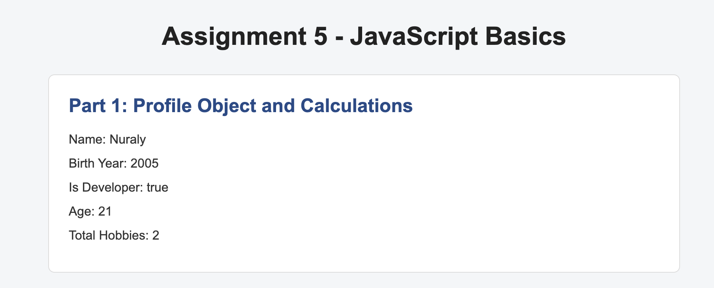
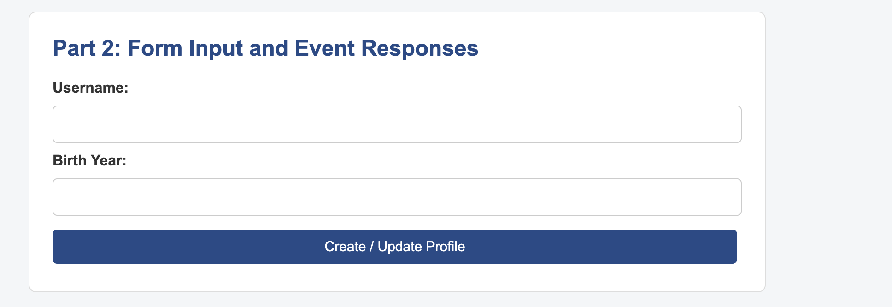
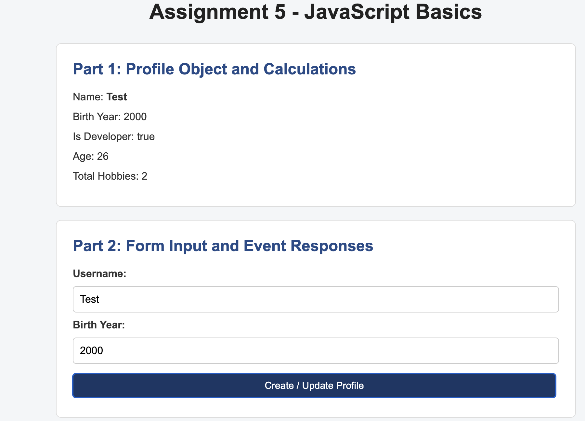
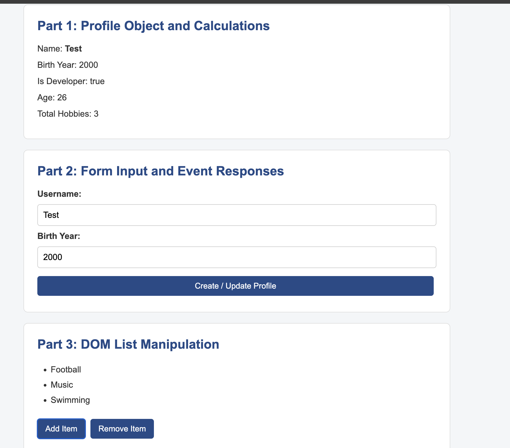

# Assignment 5 - JavaScript Basics

Name: Nuraly Adilgereyev  
Group: SE-2539

## Part 1: Profile Object, Data Types & Arithmetic

### Task 1: The Personal Info Object

I created a const object called userProfile with different data types:
- name (string)
- birthYear (number)
- isDeveloper (boolean)
- hobbies (array)

### Task 2: Arithmetic Calculations

I used JavaScript arithmetic operators to calculate the user's age
using the current year and birth year.

I also calculated the total number of hobbies.

The results are displayed on the page and in the console.

## Part 2: Form Input & Event Responses

### Task 3: HTML Form Setup

I created an HTML form with:
- Username input
- Birth Year input
- Create / Update Profile button

### Task 4: Event Listener

I added a submit event listener to the form.

When the button is clicked, JavaScript gets the input values
and updates the userProfile object.

The updated information is displayed on the page.

## Part 3: DOM List Manipulation

### Task 5: Creating & Removing Elements

I created an unordered list of hobbies.

The Add Item button allows the user to enter a new hobby
and adds a new li element to the list.

The Remove Item button removes the last item from the list.

## Summary

First, I created a JavaScript object and used arithmetic operators
to calculate the age and total number of hobbies.

Then, I created an HTML form and added an event listener
to update the profile information.

Finally, I used DOM manipulation to create, add and remove
elements from the hobbies list.
